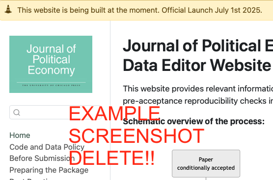

# Paper Identification

|           |                      |
|-----------|----------------------|
| ID        |  |
| Author    |    |
| Title     |     |
| Iteration |     |

Some useful information up front:

-   [JPE Data and Code Availability Policy](https://www.journals.uchicago.edu/journals/jpe/datapolicy)
-   [Step by step guidance from Data Editor for Authors](https://jpedataeditor.github.io/)
-   [Template README](https://social-science-data-editors.github.io/template_README/)

# Summary

In assessing compliance with our [Data and Code Availability Policy](https://www.journals.uchicago.edu/journals/jpe/datapolicy), our reproducibility team has identified the following issues, which we ask you to address:

1.  Data Editor's first point.
2.  Data Editor's second point.

# General

-   [x] Data Availability and Provenance Statements

    -   [x] Statement about Rights - Part 1: Right to use the data (e.g. *did the authors lawfully obtain the data*)
    -   [ ] Statement about Rights - Part 2: Right to publish the data (e.g. *are human subjects involved and did permission been granted to publish their data?*)
    -   [ ] License for Data (optional, but recommended)
    -   [x] Details on each Data Source

-   [x] Dataset list

-   [x] Computational requirements

    -   [x] Software Requirements
    -   [x] Controlled Randomness (as necessary)
    -   [x] Memory, Runtime, and Storage Requirements

-   [x] Description of programs/code

    -   [ ] License for Code (Optional, but recommended)

-   [x] {REPLICATOR} to Replicators

    -   [ ] Details (as necessary)

-   [ ] List of tables and programs

-   [x] References (Optional, but recommended)

-   Check L'Ecuyer-CMRG code license

-   Download of one data source

-   Double folder of replication-package/replication_package

-   simulation study or observational data?

# High-level Description of Research Project

*This research project...*

-   [x] uses observational data.
-   [ ] uses *confidential* observational data.
-   [ ] uses data generated via experiment or trial by the authors (in field or lab).
    -   [ ] For lab experiments: The code to implement the experimental protocol (z-Tree, o-Tree etc) is included in the package.
    -   [ ] A PDF copy of IRB approval is contained in the package.
    -   [ ] A PDF document outlining the design of the experiment, including information on the selection and eligibility of participants is included.
    -   [ ] A PDF copy of the instructions given to participants in both original language and an English translation is included.
-   [ ] uses data generated via survey by the authors (in field or online)
    -   [ ] The programs used to administer the survey (e.g. qualtrics survey file) are included.
    -   [ ] A PDF copy of IRB approval is contained in the package.
    -   [ ] A PDF of the original questionaire(s) and information on the selection and eligibility of participants is included.
-   [ ] is a simulation study: the data are generated by an algorithm.
-   [ ] is a numerical illustration: no data are used but code is used to produce illustrative output (tables, figures)

# Data description

## Data Sources

| file/name | public | private | shared with us | DOI/URL | Access described | cited readme | cited paper |
|---------|---------|---------|---------|---------|---------|---------|---------|
| data/raw/facebook100.zip | yes | no | no | yes | yes | yes | yes |

# Requirements

> {REPLICATOR}: Check that these requirements are met.

-   [x] README is in TXT, MD, or PDF format
-   [x] README is accessible at the root of the package (not inside a folder)
-   [ ] Title conforms to guidance (starts with "Data and Code for: Title of Paper" or "Code for: Title of Paper", is properly capitalized)
-   [ ] Authors (with affiliations) are listed in the same order as on the paper

> {REQUIRED} Please review the title of the deposit as per our guidelines.

> {REQUIRED} Please review authors and affiliations on the deposit. In general, they are the same, and in the same order, as for the manuscript; however, authors can deviate from that order.

## Stated Requirements

-   [ ] No requirements specified
-   [x] Software Requirements specified as follows:
    -   R, tested with R 4.6.0, with the package igraph (tested with 2.3.4; install.packages("igraph"); on Linux, installing it from source needs a C++ compiler and, for full functionality, the GLPK, GMP and libxml2 development libraries; a binary repository such as Posit Package Manager avoids this) and the base packages parallel, tools and utils.
    -   A C compiler set up for R, strongly recommended: Xcode Command Line Tools on macOS (xcode-select --install), the Rtools version matching your R version on Windows, or gcc and make on Linux (e.g. the Debian/Ubuntu package r-base-dev, which also installs build-essential). code/lib/signal_counting.c is compiled automatically on first use (log in output/build/compile_log.txt), with R's default compiler settings plus -ffp-contract=off, first ignoring and, if that fails, using a personal \~/.R/Makevars. Without a compiler, the scripts use an equivalent pure-R implementation, which agrees with the compiled one up to rounding error (relative differences below 1e-8 in the tests) but is much slower in step 05: for the largest school, about 33 seconds per ordering instead of 4, so that step 05 would take days.
    -   Python, tested with Python 3.14.5, numpy 2.5.2, scipy 1.18.0 and matplotlib 3.10.8 (pip install -r requirements.txt). These pinned versions need Python 3.12 or later; with an older Python, install the most recent versions of the three packages available for it (the code was tested only with the versions above).
-   [x] Computational Requirements specified as follows:
    -   MacBook Pro with an Apple M5 Pro processor (15 cores) and 48 GB of memory, running macOS 27.0.1, with R 4.6.0 and Apple clang 21.0.0 (no GPU is used)
    -   At least 8 GB of memory is needed with one worker, and 16 GB is recommended. Disk space: 0.2 GB for the raw data, 0.3 GB for the derived data (twice that briefly while step 04 runs), under 0.1 GB for outputs, plus the R and Python installations.
-   [x] Time Requirements specified as follows:
    -   9 hours with 8 parallel workers or 36 hours with one worker
-   [x] Requirements are complete.

For missing requirements, see the list of required changes in @sec-findings

# Analyzing Data and Code Files













## Code description

> {REPLICATOR}: Review the code (but do not run it yet). Identify programs that create "analysis files" ("data preparation code"). Identify programs that create tables and figures. Not every deposit will have separate programs for this.

> {REPLICATOR}: Identify all **Figure, Table, and any in-text numbers**. Create a list, mapping each of them to a particular program and line number within the program (use [this template](package-output-map.xlsx)). Commit that list. You will come back to the list in your findings. IN THIS SECTION, point out only a summary description, including of shortcomings. E.g.

> {REPLICATOR}: For example, you could write "There are four provided Stata do files, three Matlab .m files, including a "master.do"." {REPLICATOR}: And you could list the issues you encounter: {REPLICATOR}: - Table 5: could not identify code that produces Table 5 {REPLICATOR}: - Neither the program codes, nor the README, identify which tables are produced by what program.

There are 10 R scripts of which one is the master `run_all.R`, 2 Python scripts and a C++ script.







-   [x] The replication package contains a "main" or "master" file(s) which calls all other auxiliary programs.

## Computing Environment of the Replicator

-   Mac Laptop M2 MacBook Pro, MacOS 10.14.6, 8 GB of memory, (M2 Processor, 8 cores)
-   RedCloud Servers: Intel Xeon Processor (Skylake) 3.09 GHz (18 processors), Installed Ram 176 GB, 64-bit operating system, x64-based processor
-   CCSS Cloud: Windows Server AMD EPYC 7763 64-Core Processor 2.44 GHz, 128GB
-   BioHPC Linux server, Rocky Linux 9.0, AMD Opteron Processor 6380 / 16 cores/ 125 GB memory (adjust as necessary from output of linux-system-info.sh)
-   WholeTale (describe the environment chosen)
-   CodeOcean (describe the type of capsule chosen) Intel(R) Xeon(R) Platinum 8259CL CPU \@ 2.50GHz (16 cores), 128 GB Memory
-   Bitbucket Pipelines, "Ubuntu 20.04.2 LTS", Intel(R) Xeon(R) Platinum 8259CL CPU \@ 2.50GHz, 8 cores, 9GB memory
-   Codespaces, "Ubuntu 20.04.2 LTS", Intel(R) Xeon(R) Platinum 8272CL CPU \@ 2.60GHz, 2 core, 8GB/ 4-core, 16GB/ 8-core, 32 GB/ 16-core, 64GB (choose appropriately)

> {REPLICATOR}: Please also list the software you used (specific versions). List only the ones you used, add any not listed in the examples:

-   Stata/MP 18.0
-   Matlab R2022a
-   Intel Compiler 3.14152 (note: there is no such thing, so please verify the version!)

# Replication

> {REPLICATOR}: provide details about your process of accessing the code and data.
>
> -   Do NOT detail things like "I save them on my Desktop".
> -   DO describe actions that you did as per {REPLICATOR} ("I added a config.do")
> -   DO describe any other actions you needed to do ("I had to make changes in multiple programs"), without going into TOO much detail.
>
> BUT:
>
> -   DO provide ENOUGH detail so that an author, without access to the logs, can understand what needed to be fixed, including a copy-paste of the error message.
> -   DO commit to git before EACH new run with corrected code.
> -   DO (after all debugging is completed) a full run through the data, top-to-bottom, once all bugs are fixed, using the approriate method (command line or right-click).

Example:

-   Downloaded code and data from dropbox.
-   Executed the command to download the data source as per README.txt but got an error in bash

``` bash
(base) nuvolos@nuvolos:/files$ curl -L -o data/raw/facebook100.zip https://archive.org/download/oxford-2005-facebook-matrix/facebook100.zip
  % Total    % Received % Xferd  Average Speed   Time    Time     Time  Current
                                 Dload  Upload   Total   Spent    Left  Speed
  0     0    0     0    0     0      0      0 --:--:-- --:--:-- --:--:--     0
Warning: Failed to open the file data/raw/facebook100.zip: No such file or 
Warning: directory
  0   172    0     0    0     0      0      0 --:--:--  0:00:01 --:--:--     0
curl: (23) Failure writing output to destination
```

-   Had to add undocumented package `distinct` to the install portion of the config file. Ran again.
-   Code failed because of a typo in the name of the file "`superdata.dta`" (was: `superdta.dta`). Fixed. Ran again.
-   Code ran to completion.

> {REPLICATOR}: You are done now with the actual replication task. We now move to writing your report.

# Findings {#sec-findings}

> {REPLICATOR}: Describe your findings both positive and negative in some detail, for each **Data Preparation Code, Figure, Table, and any in-text numbers**. You can re-use the Excel file created under *Code Description*. When errors happen, be as precise as possible. For differences in figures, provide both a screenshot of what the manuscript contains, as well as the figure produced by the code you ran. For differences in numbers, provide both the number as reported in the manuscript, as well as the number replicated. If too many numbers, contact your supervisor.
>
> Screenshots are best added to this `.qmd` file via the VScode extension [markdown paste](https://marketplace.visualstudio.com/items/?itemName=telesoho.vscode-markdown-paste-image). You need to find out how your OS can screenshot to the system clipboard (on my mac I have to do shift+control+cmd+4 instead of only the usual shift+cmd+4 to achieve this). Once you took the screen shot, you can use the markdown paste extension to literally *paste* the image into this qmd. It will create a filename with a timestamp. I set the preferences for the extension (in hidden folder `.vscode`) so that your screenshots go to the `images/` folder automatically. You want to commit that folder together with this file. Go into the command console of VScode and type "Markdown Paste" and memorize the shortcut (or just hit enter). You can modify the filename - no need. You end up with something like this:

{width="80%"}

> If you can, add **textual output instead of screenshots**. I.e. if a script spits out an error, copy and paste the error into a code block (the thing delimited by three backticks \`\`\`\`\` below), don't take a screen shot of your terminal. Here is an example (notice you should decorate the code block with the relevant language):

``` julia

julia> using RES
[ Info: Welcome to RES.jl
[ Info: First tell us which journal you are handling in this session.
❯❯❯ Which Journal are you working on? 
  EJ, EctJ
EJ
[ Info: Setting up email
[ Info: Running in production mode
┌ Warning: not in test mode!
└ @ RES ~/git/EJData/RES.jl/src/gsheets.jl:53
Python error:
PyError ($(Expr(:escape, :(ccall(#= /Users/floswald/.julia/packages/PyCall/1gn3u/src/pyfncall.jl:43 =# @pysym(:PyObject_Call), PyPtr, (PyPtr, PyPtr, PyPtr), o, pyargsptr, kw))))) <class 'google.auth.exceptions.RefreshError'>
RefreshError('invalid_grant: Token has been expired or revoked.', {'error': 'invalid_grant', 'error_description': 'Token has been expired or revoked.'})
  File "/Users/floswald/.julia/conda/3/aarch64/lib/python3.10/site-packages/google/oauth2/credentials.py", line 344, in refresh
    ) = reauth.refresh_grant(
  File "/Users/floswald/.julia/conda/3/aarch64/lib/python3.10/site-packages/google/oauth2/reauth.py", line 365, in refresh_grant
    _client._handle_error_response(response_data, retryable_error)
  File "/Users/floswald/.julia/conda/3/aarch64/lib/python3.10/site-packages/google/oauth2/_client.py", line 72, in _handle_error_response
    raise exceptions.RefreshError(
```

## Missing Requirements

> {REPLICATOR}: If the replication package contains Stata programs run `tools/Stata_scan_code/scan_packages.do`, ensuring that you update the global `codedir` first. If the data is accessible, add any packages not mentioned in the README to the `config.do` and paste the excel output as a table below. If the data is restricted-access and not obtainable in a reasonable amount of time, paste the excel output as a table below.

> {REPLICATOR}: If it turns out that some requirements were not stated/ are incomplete (software, packages, operating system), please list the *missing* list of requirements here. Remove lines that are not necessary. If the stated requirements are complete, delete this entire section, including the \[REQUIRED\] tag at the end.

-   [ ] Software Requirements
    -   [ ] Stata
        -   [ ] Version
        -   Packages go here
    -   [ ] Matlab
        -   [ ] Version
    -   [ ] R
        -   [ ] Version
        -   R packages go here
    -   [ ] Python
        -   [ ] Version
        -   Python package go here
    -   [ ] REPLACE ME WITH OTHER
-   [ ] Computational Requirements specified as follows:
    -   Cluster size, disk size, memory size, etc.
-   [ ] Time Requirements
    -   Length of necessary computation (hours, weeks, etc.)

> \[REQUIRED\] Please amend README to contain complete requirements.

You can copy the section above, amended if necessary.

## Data Preparation Code

Examples:

-   Program `1-create-data.do` ran without error, output expected data
-   Program `2-create-appendix-data.do` failed to produce any output.

## Tables and Figures

> {REPLICATOR}: Insert the filled-out `package-output-map.xlsx` here (complete the column `Reproduced?`), using the VS Code Plugins [Excel to Markdown table](https://marketplace.visualstudio.com/items?itemName=csholmq.excel-to-markdown-table). Then describe in more detail the issues that may have arisen.

Examples:

-   Table 1: Looks the same
-   Table 2: (contains no data)
-   Table 3: Minor differences in row 5, column 3, 0.003 instead of 0.3

> {REPLICATOR}: For tables, simple comparisons can be listed out as above. More complex differences can be described by using screenshots of the original table and the reproduced table, highlighting the differences.

> {REPLICATOR}: Please provide a comparison with the paper when describing that figures look different. Use a screenshot for the paper, and the graph generated by the programs for the comparison. Reference the graph generated by the programs as a local file within the repository.

Example:

-   Figure 1: Looks the same
-   Figure 2: no program provided
-   Figure 3: Paper version looks different from the one generated by programs:

::: {#fig-three layout-ncol="2"}


Figure 3 \[DELETE THIS FIGURE\]
:::

## In-Text Numbers

> {REPLICATOR}: list page and line number of in-text numbers. If ambiguous, cite the surrounding text, i.e., "the rate fell to 52% of all jobs: verified".

-   [ ] In-text numbers not verified.

-   [ ] There are no in-text numbers, or all in-text numbers stem from tables and figures.

-   [ ] There are in-text numbers, but they are not identified in the code

-   Page 21, line 5: Same

## Other Issues

> {REPLICATOR}: List here any other issue that was not recalled previously. Delete the entire section if no additional issues were found. Don't forget to amend the examples provided.

Example:

-   Title of the Readme does not match title of the paper.

-   One or multiple scripts include hard-coded numbers whose origin is unknown.

-   Readme recalls scripts that are not provided in the replication package.

# Classification

> {REPLICATOR}: Make an assessment here.
>
> Full reproduction can include a small number of apparently insignificant changes in the numbers in the table. Full reproduction also applies when changes to the programs needed to be made, but were successfully implemented.
>
> Partial reproduction means that a significant number (\>25%) of programs and/or numbers are different.
>
> Note that if some data is confidential and not available, then a partial reproduction applies. This should be noted in the Reasons.
>
> Note that when all data is confidential, it is unlikely that this exercise should have been attempted.
>
> Failure to reproduce: only a small number of programs ran successfully, or only a small number of numbers were successfully generated (\<25%). This also applies when all data is restricted-access and none of the **main** tables/figures are run.

-   [ ] full reproduction
-   [ ] full reproduction with minor issues
-   [ ] partial reproduction (see above)
-   [ ] not able to reproduce most or all of the results (reasons see above)

## Reason for incomplete reproducibility

> {REPLICATOR}: mark the reasons here why full reproduciblity was not achieved, and enter this information in new issue on the github repo of this package. When results are fully reproduced, leave this section here, and mark "None".

-   [ ] None.
-   [ ] `Discrepancy in output` (either figures or numbers in tables or text differ)
-   [ ] `Bugs in code` that were fixable by the replicator (but should be fixed in the final deposit)
-   [ ] `Code missing`, in particular if it prevented the replicator from completing the reproducibility check
    -   [ ] `Data preparation code missing` should be checked if the code missing seems to be data preparation code
-   [ ] `Code not functional` is more severe than a simple bug: it prevented the replicator from completing the reproducibility check
-   [ ] `Software not available to replicator` may happen for a variety of reasons, but in particular (a) when the software is commercial, and the replicator does not have access to a licensed copy, or (b) the software is open-source, but a specific version required to conduct the reproducibility check is not available.
-   [ ] `Insufficient time available to replicator` is applicable when (a) running the code would take weeks or more (b) running the code might take less time if sufficient compute resources were to be brought to bear, but no such resources can be accessed in a timely fashion (c) the replication package is very complex, and following all (manual and scripted) steps would take too long.
-   [ ] `Data missing` is marked when data *should* be available, but was erroneously not provided, or is not accessible via the procedures described in the replication package
-   [ ] `Data not available` is marked when data requires additional access steps, for instance purchase or application procedure.
-   [ ] `Missing README` is marked if there is no README to guide the replicator, or the README is not in compliance with JPE requirements



> {REPLICATOR} You are done! Time to submit your report now!
>
> You must commit everything you want the Data Editor to be able to see to this git repository and push to the github remote. In particular, commit all files needed to compile your report, as well as the pdf version of your compiled report.
>
> Your commit message should reflect the state of this package; i.e. which round, whether it's complete (or not), if not, brief issue description.

> {REPLICATOR} Don't forget to delete all those REPLICATOR instructions before you commit the files!!!

> {REPLICATOR} I leave this here 👇 as a reminder for you. Please delete those commands before you commit your report:

``` bash
git add package-output-map.xlsx
git add images # for your screenshots
git add TEMPLATE.qmd  # your edits
git add TEMPLATE.pdf  # the compiled version of your report
git commit -m 'first round report. code breaks. missing citations.'
# which round is this? fill in for which_round={round1, round2, ...}
git push origin which_round
```
